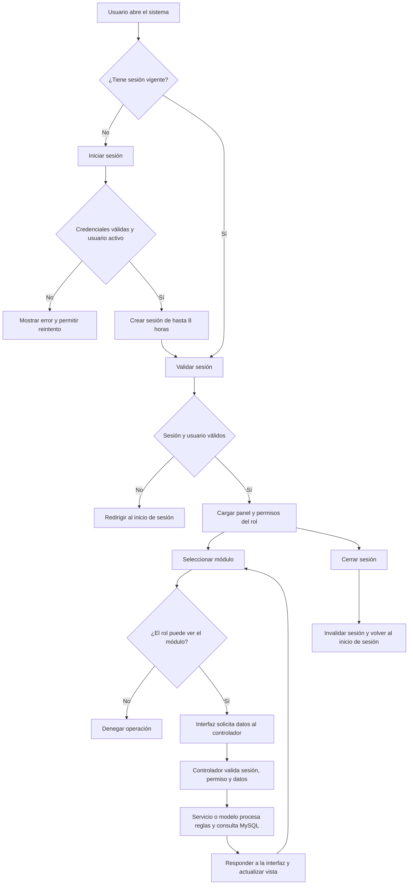
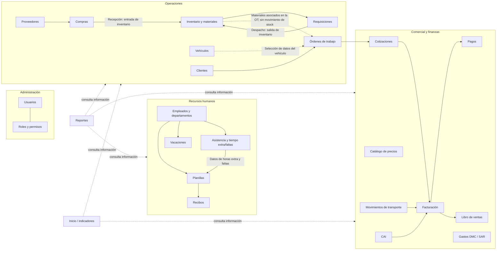
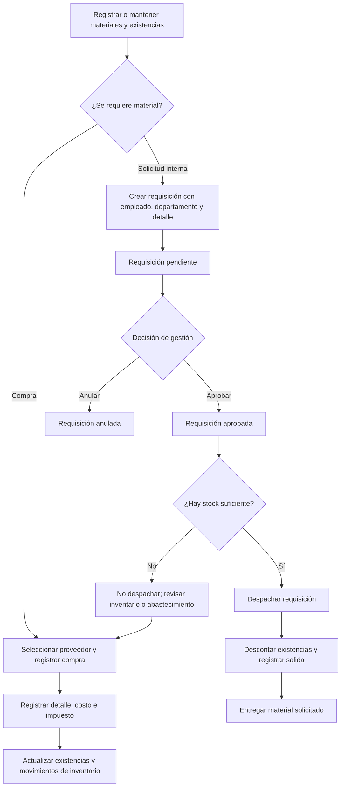
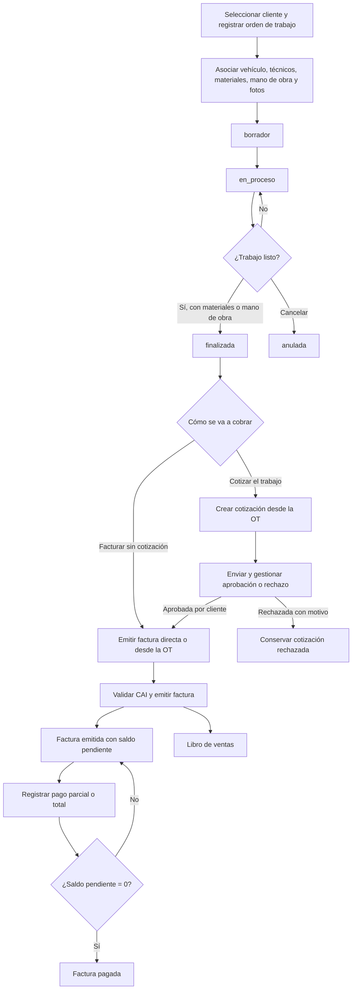
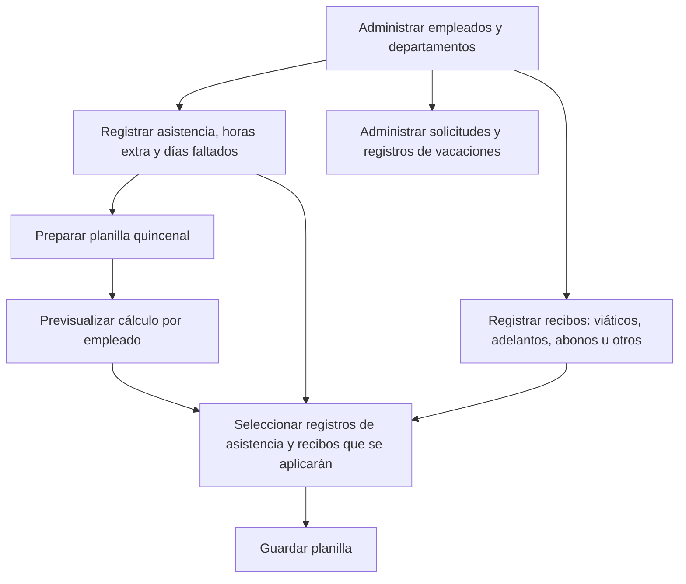

# Flujo de procesos del sistema administrativo VAMER

## Propósito y alcance

Este documento describe los procesos visibles en el sistema implementado: acceso, navegación, áreas administrativas, operación, comercial, recursos humanos y análisis. Los diagramas reflejan el comportamiento encontrado en el código y en la estructura de datos; no sustituyen políticas internas ni representan aprobaciones externas que no estén registradas en la aplicación.

## 1. Flujo general de uso

El acceso al panel usa una cookie de sesión y el navegador conserva datos de presentación del usuario. Las peticiones de los módulos consultan controladores PHP, que devuelven respuestas JSON; las operaciones de negocio se apoyan en modelos, servicios y la base de datos MySQL.

## 2. Mapa general de áreas y procesos

El mapa indica relaciones funcionales encontradas, no que cada flecha represente una transferencia automática. Las requisiciones y las compras son procesos separados: despachar una requisición descuenta existencias; registrar una compra agrega materiales al inventario mediante el mecanismo de base de datos usado por el sistema. Los materiales registrados en una orden de trabajo son una lista de referencia y no descuentan existencias.

## 3. Procesos principales

### 3.1 Operación y abastecimiento

- La requisición puede asociarse con empleado, departamento, cliente y número de orden de trabajo. El despacho exige stock suficiente para los materiales vinculados al inventario y deja movimientos de salida.
- Las compras registran proveedor, documento, fecha, detalle, impuesto y total. Los detalles de compra alimentan el inventario y actualizan información de costo/precio del material.
- El sistema permite gestionar clientes, vehículos, proveedores, materiales, categorías, inventario y movimientos de inventario como registros relacionados.
- El flujo muestra aprobación antes del despacho como recorrido operativo recomendado. En el controlador, los estados admitidos son `pendiente`, `aprobada`, `despachada` y `anulada`; la validación de stock se ejecuta específicamente al cambiar a `despachada`.

### 3.2 Orden de trabajo, cotización, factura y cobro

Estados de orden de trabajo implementados en el servicio:

| Estado actual | Siguiente estado permitido |
|---|---|
| `borrador` | `en_proceso`, `anulada` |
| `en_proceso` | `finalizada`, `anulada` |
| `finalizada` | `cotizado`, `facturada` |
| `cotizado` | `facturada` |
| `facturada` | Sin transición |
| `anulada` | Sin transición |

Una OT no se puede finalizar si no contiene materiales ni mano de obra. Las cotizaciones pueden crearse desde una OT finalizada o directamente; también existe cotización agrupada en una sola factura si todas las cotizaciones están aprobadas para el cliente y corresponden al mismo cliente. El sistema permite registrar pago parcial o total, calcula el saldo y no permite cobrar por encima del saldo pendiente. También contempla anulación de factura con motivo y administración de CAI.

### 3.3 Movimientos de transporte

1. Registrar el movimiento con tipo, fecha/hora, cliente, destino y datos disponibles del transporte (contenedor, chasis, motorista, placa, tarifa, entre otros).
2. El movimiento se crea como `pendiente`.
3. Consultar los pendientes del cliente y seleccionar movimientos para facturación.
4. Al facturar, asociarlos a una factura y marcarlos como `facturado`.
5. Los movimientos anulados o ya facturados no se pueden editar o anular por el flujo normal del módulo.

### 3.4 Recursos humanos

La planilla considera salario quincenal, horas extra, faltas, seguro privado según ubicación y otros conceptos registrados. Los registros de asistencia y recibos se seleccionan y se vinculan a la planilla; no se presupone su aplicación automática sin revisión. El módulo también permite generar planillas especiales de catorceavo y aguinaldo. Vacaciones se administran en su módulo.

### 3.5 Administración, gastos y análisis

- **Usuarios, roles y permisos:** mantener cuentas, asignar roles y configurar permisos por módulo/acción. El menú filtra módulos según permiso de visualización; las operaciones protegidas también validan permisos en el servidor.
- **Gastos DMC / SAR:** registrar y consultar gastos y sus detalles. Es un proceso financiero independiente de facturas y planillas.
- **Inicio y reportes:** Inicio presenta indicadores de ventas, cuentas por cobrar, cotizaciones por facturar, órdenes en proceso y stock bajo. Reportes ofrece consultas de ventas, cuentas por cobrar, retenciones, inventario, rentabilidad de OT y salidas de planilla.
- **Catálogo de precios:** mantener precios de referencia para las operaciones comerciales.
- **Libro de ventas:** consultar las ventas por período a partir de la información de facturación.

## 4. Módulos cubiertos

El menú actual agrupa los módulos de esta manera:

| Área | Módulos |
|---|---|
| Inicio | Inicio |
| Administración | Usuarios; Roles y permisos |
| Operaciones | Clientes; Vehículos; Inventario; Requisiciones de materiales; Compras; Proveedores; Órdenes de trabajo |
| Comercial | Cotizaciones; Movimientos; Catálogo de precios; Facturación; CAI; Libro de ventas; Pagos; Gastos DMC |
| RRHH | Planillas quincenales y especiales (catorceavo / aguinaldo); Vacaciones; Recibos; Tiempo extra y faltas |
| Análisis | Reportes |

## 5. Referencias de implementación

- Entrada, autenticación del panel y carga de módulos: `dashboard.php`, `controllers/AuthController.php`, `config/auth.php`.
- Flujos comerciales: `services/OrdenService.php`, `services/CotizacionService.php`, `services/FacturacionService.php`.
- Abastecimiento y requisiciones: `models/CompraModel.php`, `models/RequisicionModel.php`.
- Órdenes y movimientos: `models/OrdenModel.php`, `models/MovimientoModel.php`.
- Recursos humanos: `models/PlanillaModel.php`, `models/PlanillaEspecialModel.php`, `models/AsistenciaModel.php`, `controllers/VacacionesController.php`, `models/ReciboModel.php`.
